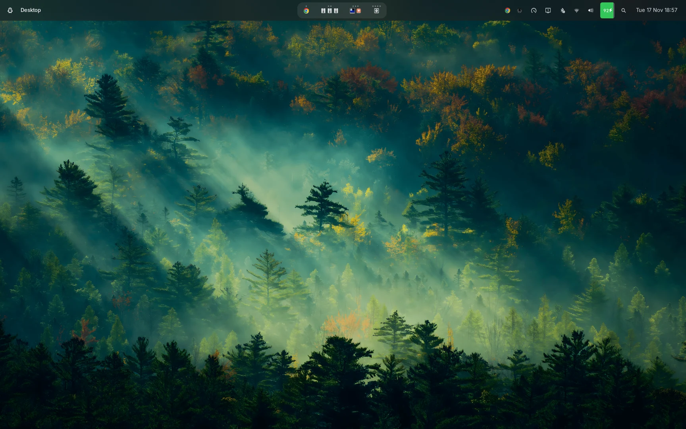
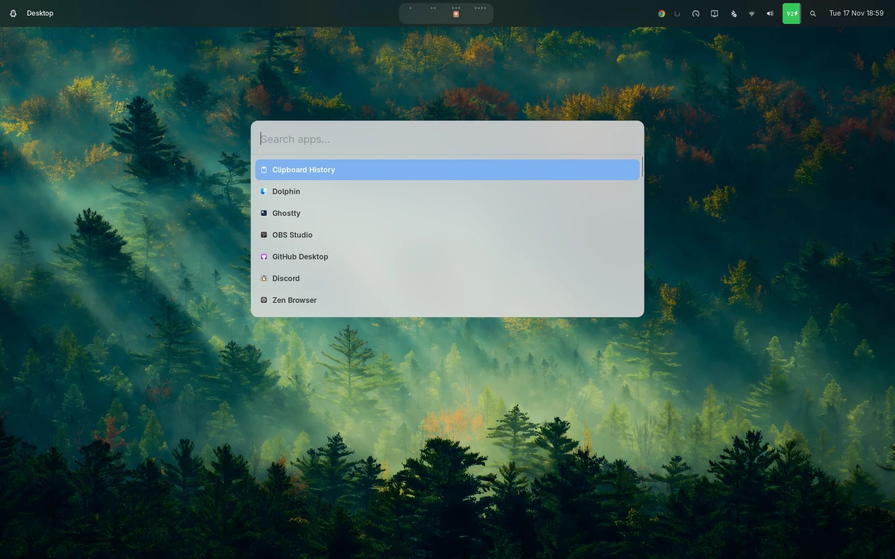
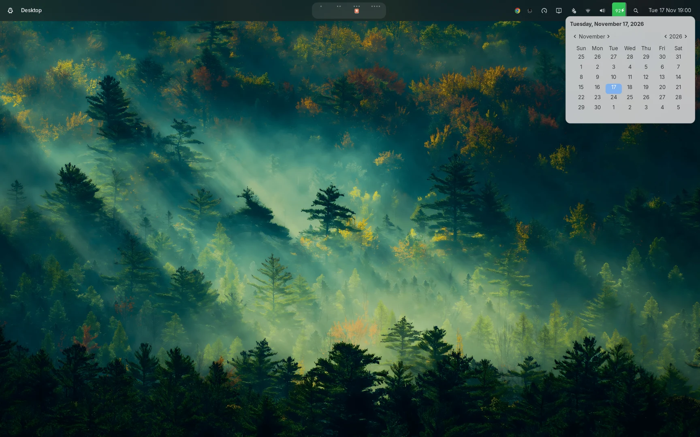
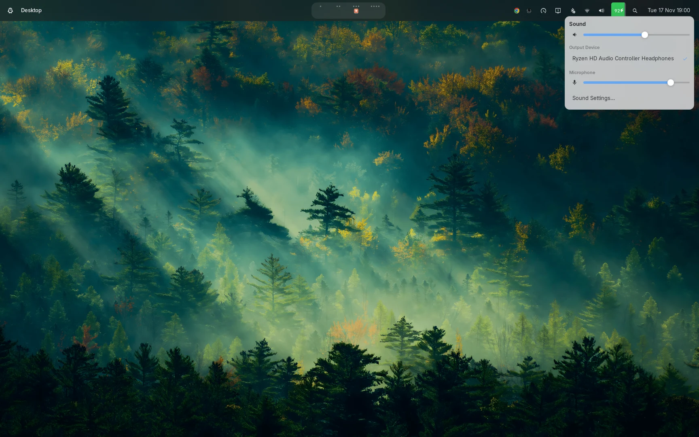
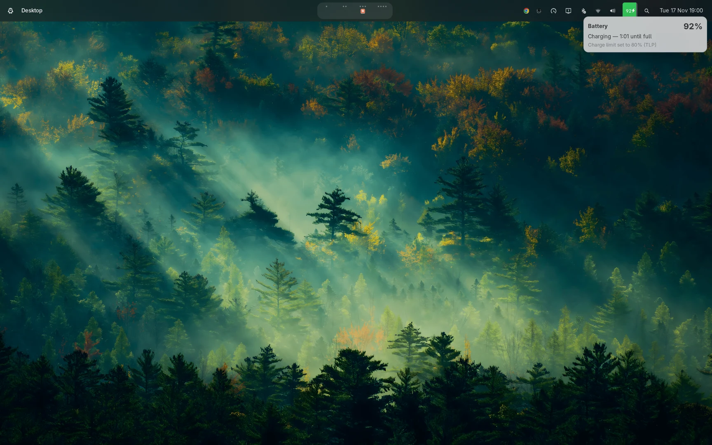
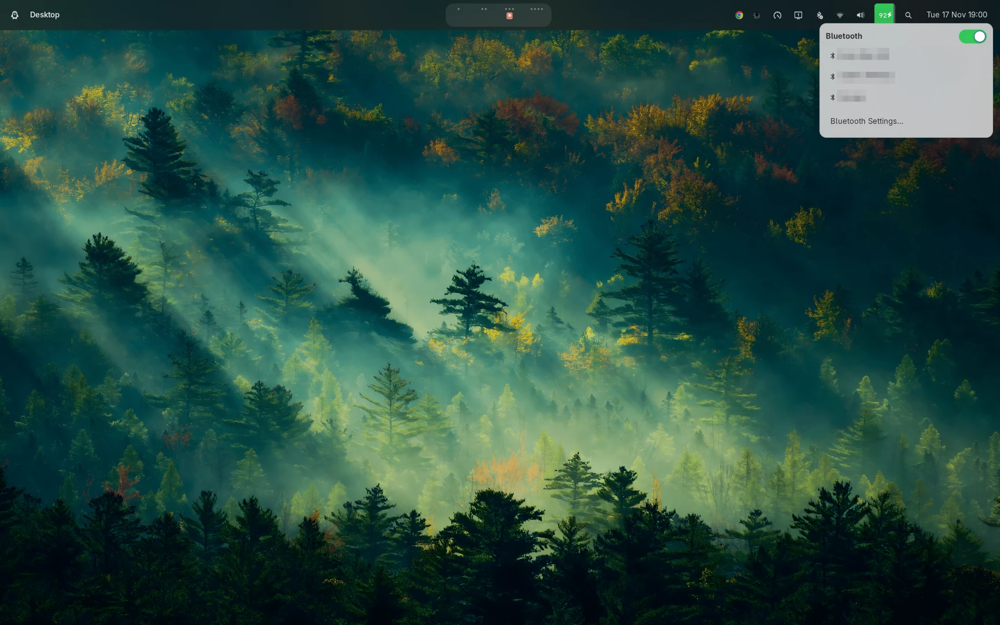
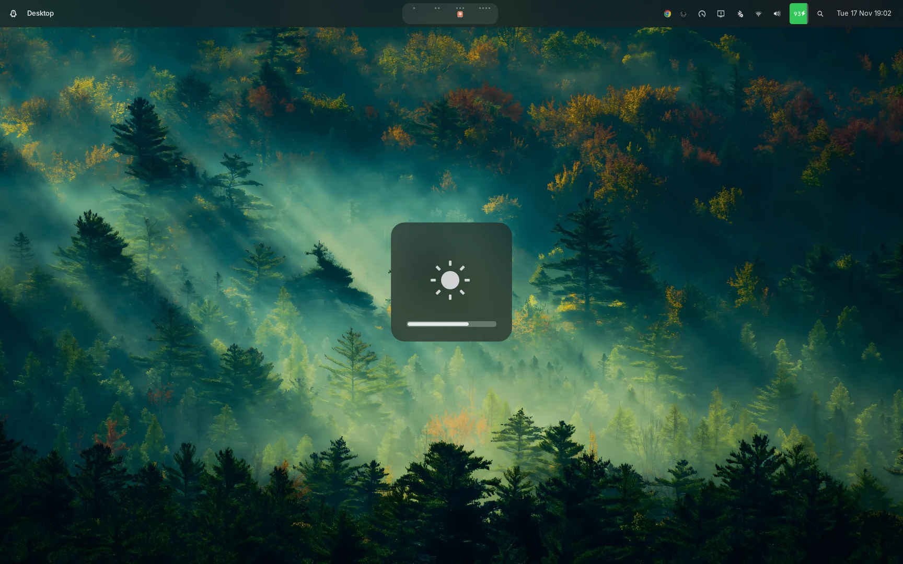

# Arch + Hyprland, made to feel like macOS

A Wayland desktop built around one idea: **the key next to the spacebar
should behave like a Mac's Command key.** Everything else — the menu bar, the
launcher, Mission Control, the OSD, the trackpad gestures — follows from
wanting the muscle memory to transfer.

The shell is [AGS/Astal](https://github.com/Aylur/ags) (GTK3 + TypeScript),
not Waybar. Mission Control is a patched build of the `hyprexpo` plugin.

> **Hardware note.** This is tuned for an **ASUS Vivobook** (Ryzen 7 6800H,
> MediaTek MT7922 Wi-Fi, 1728x1080 internal panel). It will *run* anywhere,
> but the display scale, the touchpad device name, the ASUS-specific
> backlight keys and the battery charge cap are all specific to that
> machine. See [Adapting to other hardware](#adapting-to-other-hardware).

---

## Screenshots

The menu bar: Apple menu, focused-app name, workspace pills with live app
icons, tray, and status widgets. Everything is AGS — there is no Waybar here.



`Cmd+Space` opens a Raycast-style launcher, frosted over the wallpaper by a
Hyprland `layerrule`.



Clicking a status icon opens a popover. These aren't `Gtk.Popover` — a GTK3
layer-shell bar clips them to its own 28px height, so each is a fullscreen
transparent layer with its content positioned by computed margins.

| | |
|---|---|
|  |  |
|  |  |

The battery panel surfaces the TLP charge cap from
[`system/etc/tlp.d/10-battery.conf`](system/etc/tlp.d/10-battery.conf).
Network names and Bluetooth device names are pixelated in these shots.



Media and brightness keys route through [`scripts/osd.sh`](scripts/osd.sh),
which applies the change and then draws a macOS-style overlay — volume,
screen brightness, night shift, and keyboard backlight:

| Volume | Brightness | Night shift | Keyboard |
|---|---|---|---|
|  |  |  |  |

> Mission Control isn't pictured — the hyprexpo plugin doesn't currently load.
> See [Troubleshooting](#troubleshooting).

---

## Install

```sh
git clone <this-repo> ~/dotfiles
cd ~/dotfiles
./install.sh
```

Re-running is safe. Anything that would be overwritten is moved to
`~/.dotfiles-backup-<timestamp>/` rather than deleted, and each step checks
whether it's already been done.

| Flag | Effect |
|---|---|
| `--dry-run` | Print every action, change nothing. **Start here.** |
| `--no-packages` | Skip pacman/AUR; just link configs and build |
| `--no-build` | Skip compiling hyprexpo and toplevel-capture |

The script installs 181 pacman + ~19 AUR packages, symlinks every config into
place, fetches the WhiteSur icon theme, generates the AGS typings, compiles
the hyprexpo plugin and the thumbnail helper, and *offers* (never assumes) to
install the TLP battery profile and enable system services.

After it finishes: log out and back in, or `hyprctl reload`.

---

## How the repo maps onto the filesystem

Config files live here and are **symlinked into place**, so editing
`~/.config/hypr/hyprland.conf` edits the file in this repo and `git diff`
shows it. There is no copy step to forget.

```
config/ags/        → ~/.config/ags        the whole desktop shell
config/hypr/       → ~/.config/hypr       compositor, keybinds, window rules
config/kitty/      → ~/.config/kitty      Cmd+C/V clipboard mapping
config/fusuma/     → ~/.config/fusuma     3-finger trackpad gestures
config/wofi/       → ~/.config/wofi       legacy, unwired (see below)
config/{ghostty,nvim}/
config/{mimeapps.list,kdeglobals,chrome-flags.conf,Claude-flags.conf}
scripts/           → ~/scripts            helper scripts the keybinds call
home/bashrc        → ~/.bashrc
home/profile       → ~/.profile
system/etc/tlp.d/  → /etc/tlp.d/          (copied, not linked — root-owned)
packages/          package + enabled-unit manifests
```

Two files are **generated** rather than linked, because they can't be shared
verbatim: `~/.gtkrc-2.0` embeds an absolute path, and `~/.gitconfig` holds a
git identity that deliberately isn't stored in this repo (`install.sh` asks
for yours).

---

## The keyboard model

`input:kb_options = altwin:swap_lalt_lwin` swaps Alt and Super at the
compositor, so the key physically next to the spacebar becomes **Super**, and
Hyprland's `$mainMod = SUPER` is therefore "Cmd". The old Windows key becomes
Alt, i.e. "Option".

Most bindings are `sendshortcut`, which translates the Mac combo into the
Linux one the focused app already understands:

| Mac habit | Does |
|---|---|
| `Cmd+C` / `V` / `X` | Sent as **Ctrl+Insert / Shift+Insert**, not Ctrl+C — so copying in a terminal doesn't SIGINT the running program. `kitty.conf` maps those to the clipboard. |
| `Cmd+Q` | Close focused window |
| `Cmd+Space` | AGS launcher |
| `Cmd+←/→` | Line start/end (`Home`/`End`) |
| `Cmd+↑/↓` | Document top/bottom |
| `Option+←/→` | Jump by word |
| `Ctrl+←/→` | Previous/next desktop (macOS Spaces) |
| `Option+1..9` | Switch desktop *within the active group* (see below) |
| `Cmd+1..9` | Switch **tab** in the focused app |
| `Option`+drag | Move/resize windows, leaving `Cmd`+click free for links |

`Cmd+W/T/F/S` are context-sensitive: `~/scripts/browser-key.sh` checks the
focused window class and sends the browser shortcut in Chrome/Zen, or does
the window-manager thing everywhere else. So `Cmd+W` closes a *tab* in a
browser and quits the app otherwise.

**The Fn key cannot be rebound** — it's handled in keyboard firmware and
never reaches the compositor. `Option+Tab` is the stand-in for Fn-based tab
switching.

---

## Desktop groups

Hyprland workspaces are one flat global list. This setup fakes macOS-style
*sets* of desktops on top of that: each group owns a private block of real
workspace IDs, far outside the 1–10 range you'd ever land on by hand, and the
menu bar only ever labels them `1..count` relative to the active group.

| Group | Real workspace IDs |
|---|---|
| Programming | 101–104 |
| Design | 201–203 |

So `Option+2` means "the 2nd desktop of whichever group is active" — a
different real workspace depending on the group. That's why the keybind calls
`ags request "desktop 2"` instead of dispatching a workspace number: only AGS
knows which group is active.

Two definitions must stay in sync, by necessity — the group blocks live in
[`config/ags/widget/lib/profiles.ts`](config/ags/widget/lib/profiles.ts),
while the per-desktop app launch commands and window placement live in
[`scripts/desktop-profile.sh`](scripts/desktop-profile.sh) (bash, reusing its
already-tested launch logic). Change `base`/`count` in one and you must
change the other.

---

## What provides what

| Piece | Comes from |
|---|---|
| Compositor | `hyprland` |
| Shell: menu bar, launcher, Mission Control, OSD, popovers | `aylurs-gtk-shell` (AGS) + `config/ags` |
| Mission Control grid | vendored `hyprexpo` fork — see [VENDORED.md](config/ags/helpers/hyprexpo-fork/VENDORED.md) |
| Window thumbnails | `helpers/toplevel-capture` (C, built by `install.sh`) |
| 3-finger gestures | `fusuma` — deliberately owns *all* swipes; Hyprland defines none |
| Cursor | `apple_cursor` (AUR) → theme `macOS` |
| Icons | WhiteSur, fetched from upstream (103M, not vendored) |
| Wallpaper | `swaybg` |
| Clipboard history | `cliphist` + `wl-clipboard` |
| Screenshots | `grim` + `slurp`, notified via `dunstify` |
| Battery/thermal | `tlp` + `system/etc/tlp.d/10-battery.conf` |

### Gestures and the OSD

Media and brightness keys don't call `wpctl`/`brightnessctl` directly — they
go through `~/scripts/osd.sh`, which applies the change *and* pushes a
`ags request "osd ..."` to draw the macOS-style overlay. Add a new one by
extending the `case` in that script.

---

## Manual steps `install.sh` can't do

- **Wallpaper.** `hyprland.conf` points `swaybg` at
  `~/Pictures/wallpapers/wallpaper.png`. No image ships with this repo
  (size + licensing); drop any file there. The directory is created for you.
- **GTK theme.** If icons look wrong, run `lxappearance` and pick
  **Adwaita** + **WhiteSur** icons + **macOS** cursors. It rewrites
  `~/.gtkrc-2.0`.
- **Hyprcursor.** `HYPRCURSOR_THEME=macOS` is set, but `apple_cursor` only
  ships an XCursor theme, so Hyprland falls back to `XCURSOR_THEME`. This
  works; cursors just aren't resolution-independent.

---

## Adapting to other hardware

Everything below is in `config/hypr/hyprland.conf` unless noted.

| Setting | Current value | Why it's specific |
|---|---|---|
| `monitor=eDP-1` | scale `1.666667` | Matches the 1728x1080 effective panel |
| `monitor=HDMI-A-1` | `1920x1080, 0x-1080` | Places an external screen *above* the laptop |
| `device { name = asue120b:00-04f3:31c0-touchpad }` | sensitivity `0.15` | Device name differs per model — find yours with `hyprctl devices` |
| `XF86KbdBrightness*`, `XF86KbdLightOnOff` | → `osd.sh kbd-*` | ASUS emits a single "cycle" key for F7 |
| `XF86TouchpadToggle` | → `osd.sh night-cycle` | F6 repurposed as a blue-light filter toggle |
| `STOP_CHARGE_THRESH_BAT0=80` (TLP) | 80% cap | `BAT0` naming and threshold support vary by vendor |
| `AMDGPU_ABM_LEVEL_ON_BAT=3` (TLP) | | AMD-only |

On a non-ASUS machine the backlight binds are the first thing to fail, and
they fail quietly — the key just does nothing.

---

## Troubleshooting

**Mission Control does nothing.** ⚠️ **This is the current known-broken
thing.** The vendored hyprexpo plugin was last built against Hyprland 0.55.4;
the system now runs 0.56.2, and a plugin is ABI-locked to the release it was
compiled against — so it silently fails to load. Confirm with:

```sh
hyprctl plugin list      # reports "no plugins loaded"
```

Fixing it needs more than a recompile, because the local patch pins a mangled
C++ symbol that likely moved in 0.56.x. See
[VENDORED.md](config/ags/helpers/hyprexpo-fork/VENDORED.md) for the full
diagnosis and procedure.

Everything else in the setup — the menu bar, launcher, OSD, gestures,
keybinds — is unaffected and works.

**Mission Control thumbnails are blank.** Rebuild the capture helper after a
Hyprland or `hyprland-protocols` upgrade:

```sh
~/.config/ags/helpers/toplevel-capture/build.sh
```

**The bar is gone / AGS won't start.** Run it in the foreground to see the
error — `ags run` hides nothing:

```sh
ags quit; ags run
```

**TypeScript errors about missing `astal` types.** The typings are generated,
not committed (80M). Regenerate:

```sh
cd ~/.config/ags && ags types -d .
```

**No bar on a newly plugged-in monitor.** Shouldn't happen — `app.ts`
rebuilds per-monitor widgets on `monitor-added`. If it does, it's a bug
there, not config.

---

## Legacy, kept but unwired

These are leftovers from the pre-AGS version of this setup (May–Jul 2025).
Nothing references them — verified by grepping the whole tree. They're kept
because they're a few KB and occasionally useful to run by hand, but **don't
expect them to do anything on their own**, and don't be misled into thinking
they're part of the live config.

| File | Superseded by |
|---|---|
| `config/wofi/` | the AGS launcher — `Cmd+Space` → `toggle_menu.sh` → `ags request "launcherToggle"` |
| `config/hypr/shaders/` | nothing; the swipe-shader approach gave way to fusuma + hyprexpo |
| `scripts/swipe_left.sh` | same — only mentioned in a dead `.frag` comment |
| `scripts/toggle-nightlight.sh` | `cycle-nightlight.sh` (5 levels via `wlsunset`) |
| `scripts/shrink_switch.sh`, `scripts/sticky-zen.sh` | never bound; manual-use utilities |

`config/waybar/` is **not** in this repo at all — the menu bar is AGS, and
`exec-once = waybar` has been commented out in `hyprland.conf` for a long
time.

## Known rough edges

- `config/hypr/shaders/swpe_right.frag` is misspelled (`swpe`, and its own
  header comment says `swipe_right.frag`). Harmless — nothing loads it.
- `~/.gtkrc-2.0` `include`s `~/.gtkrc-2.0.mine`, which LXAppearance expects
  to exist. `install.sh` touches it to silence a GTK2 warning.
- The `ags/package.json` dependency is a local path
  (`/usr/share/astal/gjs`), so it only resolves once `aylurs-gtk-shell` is
  installed.
- `profiles.ts` and `desktop-profile.sh` duplicate the desktop-group
  workspace numbers and must be edited together. There's no check that they
  agree.
